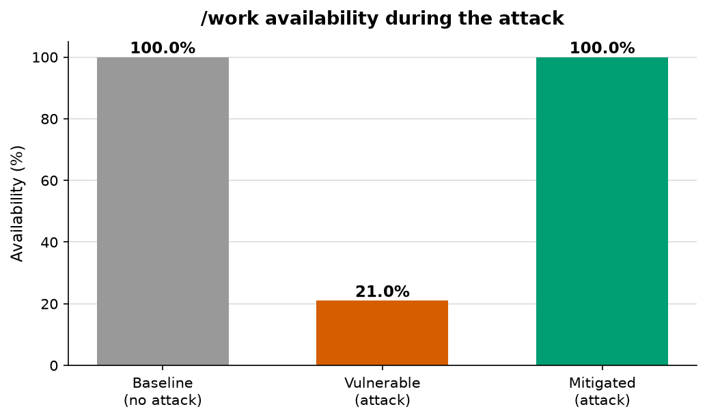
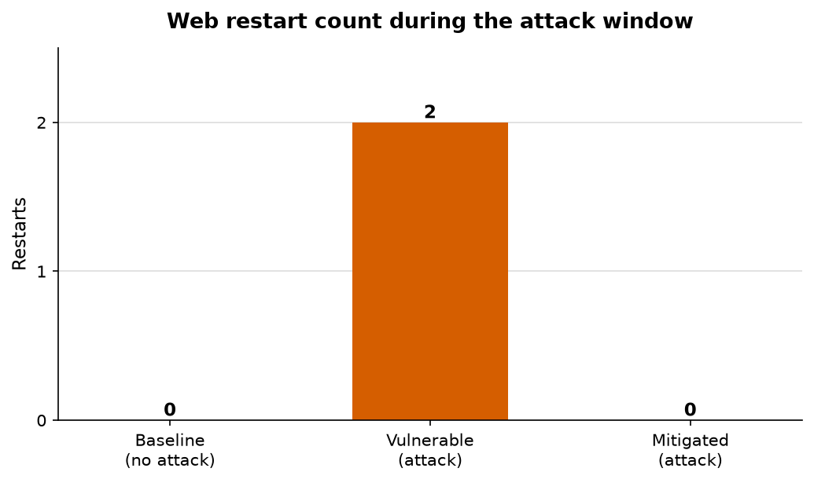

# Indirect Denial-of-Service via Health-Check Manipulation in Docker Swarm
### A Restart-Storm Availability Attack on Containerized Microservices — and its Detection and Mitigation

**Course:** Information Security (CEP-2026)
**Department:** Software Engineering, NED University of Engineering & Technology
**Instructor:** Miss Sheerina
**Group B14:**

| Name | Reg. No. |
| --- | --- |
| Muhammad Abdullah Khan | SE-23061 |
| Furqanullah | SE-23063 |
| Masroor Hassan | SE-23064 |
| Haris Masood | SE-23088 |
| Muhammad Huzaifa Hassan | SE-23089 |
| Muhammad Rafay | SE-23100 |

---

## Abstract

In Docker Swarm, a single `HEALTHCHECK` drives **two** independent decisions at
once: whether a task receives traffic, and whether a task is restarted. When
that health-check depends on an external resource such as a database, an
attacker who merely *slows the dependency* — without ever touching the victim
container — makes the health-check time out. Swarm's `restart_policy`, behaving
exactly as designed, then kills and recreates the task again and again: a
**restart storm** that takes the service offline even though the application
code is perfectly functional.

We reproduced this attack in a controlled single-node Swarm testbed, built a
real-time detector that identifies the storm and names its cause, and applied a
mitigation that separates process liveness from dependency health. Measured
before and after, the same attack drops `/work` availability to **21 %** with
**2** forced restarts on the vulnerable stack, but leaves availability at
**100 %** with **0** restarts on the mitigated stack. The detector raises its
first alert **17.7 s** after the attack begins and correctly stays silent when
no storm occurs.

---

## 1. Introduction and Motivation

Container orchestrators health-check every service and act on the result. In
Docker Swarm the same probe is overloaded: a failing probe simultaneously
removes the task from the load-balancer rotation **and** feeds the restart
decision. This coupling is convenient, widely taught, and ships by default — the
canonical tutorial health-check pings the database. It is also the root of the
vulnerability studied here.

The insight of this project is that **availability can be destroyed without
attacking the victim at all.** The application process can be healthy, answering
real requests correctly, and still be killed repeatedly by its own orchestrator
because a *dependency* it probes has been slowed. The attacker's capability
required is minimal: the ability to add latency to one network path.

## 2. Problem Description — The Indirect DoS and the Restart Storm

The failure chain has five stages and never touches the victim container:

1. The attacker slows a dependency (here, the database path) so responses take
   longer than the health-check timeout.
2. The service's `/health` probe performs a database round-trip and times out.
3. After the configured retries, Docker marks the container **unhealthy**.
4. Swarm treats the unhealthy task as failed and, under a `restart_policy` with
   no `max_attempts`, terminates and recreates it.
5. The replacement task boots, fails the same dependency-coupled probe, and is
   killed again — a continuous terminate-and-restart cycle (the *restart
   storm*). The service is unavailable for the duration.

The defining fingerprint — the **signature signal** — is a *divergence*: the
application keeps succeeding at real work while the health-check keeps failing.
In our captured logs the application logs `WORK ok` right up to each
`HEALTH fail … timeout expired`, proving the code is alive while Swarm kills it.

## 3. Relevance to Containerized Environments

This is specifically an *orchestration* problem, not a generic web-app bug:

- **Orchestrator coupling.** Swarm's single health-check drives both routing and
  restart. One failed probe triggers two corrective actions at once; there is no
  separation of concerns.
- **`restart_policy` amplification.** Auto-restart converts a transient
  dependency blip into a sustained outage. The orchestrator actively degrades
  availability *while trying to restore it* — a self-inflicted DoS.
- **Microservice blast radius.** Every service whose health-check touches a
  degraded dependency fails together; one slow database can collapse a whole
  request path in seconds.
- **Default-config exposure.** The vulnerable pattern (health-check pings the
  database) is the documented "best practice" in tutorials and Helm charts, so
  the risky configuration is shipped by default.

In a monolith where health and routing are decoupled, this class of risk is
absent. The orchestrator is what turns a *dependency failure* into an
*availability failure*.

## 4. Threat Model

- **Attacker goal:** deny availability of a target service.
- **Attacker capability:** the ability to inject latency into the network path
  between the service and one of its dependencies (modelled here with a latency
  injector). No code execution, no credentials, and no access to the victim
  container are required.
- **What the attacker never does:** touch, exploit, or even reach the victim
  web container. Only the dependency path is slowed.
- **Assumptions:** the service runs a dependency-coupled health-check (the
  default pattern) and a `restart_policy` without a bounded `max_attempts`.
- **Out of scope:** classic volumetric/network DDoS, host compromise,
  multi-node cluster effects. The single-node testbed reproduces the same
  orchestrator behaviour without them.

## 5. Testbed Design

A single-host Docker Swarm (`docker swarm init`, one Ready node) runs three
services on one overlay network:

| Service | Image | Role |
| --- | --- | --- |
| `web` | `iddos-app:vuln` / `iddos-app:fixed` | Flask victim service |
| `db` | `postgres:16` | the dependency |
| `toxiproxy` | `toxiproxy:2.9.0` | latency injector between `web` and `db` |

The web app exposes deliberately separated endpoints:

- `GET /work` — real application work, returns 200, **never touches the
  database** (proves the app is alive and correct).
- `GET /health` — the **vulnerable** probe: opens a fresh database connection
  *through Toxiproxy* and returns 200 only if it answers within a short timeout.
- `GET /healthz` — the **mitigated** liveness probe: local-only, no database.
- `GET /ready` — readiness: database-dependent, guarded by a circuit breaker.
- `GET /metrics` — Prometheus metrics for the optional live dashboard.

The application connects to the database **only through Toxiproxy**
(`DB_HOST=toxiproxy`), so the attack can slow the database path without touching
`web`. Two stack files differ only in the two settings that matter —
`stack/vulnerable.yml` (health-check probes `/health`, `restart_policy` has no
`max_attempts`) and `stack/mitigated.yml` (health-check probes `/healthz`,
`restart_policy` adds `max_attempts: 3` and a `window`). Keeping everything else
identical makes the before/after comparison clean.

## 6. Attack Demonstration — Method and Evidence

**Method.** The attack is a single action: add a latency *toxic* (5000 ms) to
the Toxiproxy route via its control API, so database replies exceed the
health-check timeout. A load generator samples `/work` throughout, and
`docker stack ps` plus the service logs are captured.

**Evidence.** During the attack:

- The restart count climbed as Swarm killed healthy tasks. The task history
  shows the cause explicitly:

  ```
  app_web.1  Shutdown  Failed  "task: non-zero exit (137): dockerexec: unhealthy container"
  ```

- The **signature signal** is visible in the application log — real work
  succeeds while the health-check fails on a dependency timeout:

  ```
  2026-11-06T21:57:04 INFO    WORK ok n=73 result=332833500
  2026-11-06T21:55:37 WARNING HEALTH fail db_ms=2003.5 detail=OperationalError:
                      connection to server at "toxiproxy" … timeout expired
  ```

- `/work` availability collapsed while the toxic was active and recovered once
  it was removed (see §9). The victim container itself was never attacked.

*(Figure placeholder: insert a screenshot of `docker stack ps app` during the
storm, showing several `Shutdown / Failed … unhealthy container` tasks, and a
screenshot of the Grafana "web UP" panel with red restart gaps.)*

## 7. Detection

`detector/monitor.py` (Docker SDK for Python) watches three signals in real
time and writes alerts to `results/alerts.log`:

1. **Health events.** Streams container `health_status` events and counts
   repeated `unhealthy` transitions in a sliding window (health flapping).
2. **Restart frequency.** Polls the service tasks and counts restarts in a
   sliding window, alerting past a configurable threshold.
3. **Signature signal.** When health fails, it probes `/work` *inside* the
   container (via `docker exec`, bypassing the de-routed ingress mesh). A 200
   proves the application is alive, so the detector reports an **indirect DoS**
   caused by dependency latency — not a crash.

Representative alerts from an attack run:

```
CRITICAL INDIRECT-DOS   app_web health=unhealthy but internal /work returns 200
                        (app logic ALIVE). Cause: dependency latency … NOT a crash.
CRITICAL HEALTH-FLAP    app_web went unhealthy 2x in 120s (health flapping).
CRITICAL RESTART-STORM  app_web restarted 2x in 120s (threshold 2).
```

The detector raised its first alert **17.7 s** after the attack began and, on
the mitigated stack, correctly produced **no alerts** (0) — there was no storm
to detect. Thresholds live in a config block so the team can tune them.

## 8. Mitigation

**Core fix (required).**

- **Separate liveness from readiness.** The container `HEALTHCHECK` now probes
  `/healthz`, a local-only liveness check that does **not** touch the database.
  A slow dependency can no longer fail the health-check, so Swarm no longer
  kills a healthy container. `/ready` keeps the database check for *routing*
  decisions only.
- **Tune the restart policy.** `restart_policy` gains `max_attempts: 3` and a
  `window: 60s`, so even a genuine failure cannot become an unbounded storm.

**Defence-in-depth (optional, implemented).**

- **Circuit breaker** around the database call: after repeated slow calls the
  breaker opens and `/ready` fails fast (≈10 ms) instead of hanging for the full
  timeout on every request.
- **Reverse proxy (HAProxy)** that health-checks `/ready` and de-routes a slow
  instance **without killing it** (`stack/mitigated-plus.yml`). Captured proof
  under latency: `/healthz → 200`, `/ready → 503`, `/work → 200`, and the
  container is never killed.

## 9. Results

All three scenarios used the same attack (5000 ms latency), a 90 s attack
window, and `/work` sampled at 5 requests/second.

| Scenario | Stack | Attack | Availability | Restarts | MTTR (s) | TTD (s) |
| --- | --- | --- | --- | --- | --- | --- |
| Baseline | vulnerable | no | **100.0 %** | 0 | — | — |
| Vulnerable + attack | vulnerable | yes | **21.0 %** | 2 | 13.0 | 17.7 |
| Mitigated + attack | mitigated | yes | **100.0 %** | 0 | 0.2 | — |

*Metrics:* **Availability** = share of `/work` requests returning 200;
**Restarts** = web task restarts in the attack window; **MTTR** = seconds from
the toxic being removed to the web service becoming healthy again;
**TTD** (time-to-detection) = seconds from attack start to the detector's first
alert (`—` = no alert, i.e. no storm to detect).





**Reading the results.** On the vulnerable stack the attack is devastating:
availability falls to roughly one-fifth and the orchestrator forces repeated
restarts. On the mitigated stack the *same* attack is a non-event: availability
holds at 100 %, no restarts occur, and recovery is immediate. This meets every
acceptance target set for the project (availability ≥ 95 %, restarts low/zero,
short MTTR, detection ≤ 30 s).

## 10. Conclusion and Future Work

An orchestrator feature intended to improve availability — automatic restart on
a failed health-check — becomes an availability *weapon* when the health-check
is coupled to an external dependency. The attack needs no exploit on the victim;
it only slows a dependency. The fix is architectural and inexpensive: **separate
process liveness from dependency health** and **bound the restart policy**. Our
measurements show the mitigation neutralises the attack completely in this
testbed.

**Future work.** Extend to a multi-node cluster and multiple dependent services
to observe cascade/blast-radius effects; compare Swarm's behaviour with
Kubernetes liveness/readiness/startup probes; add automated alerting rules in
Prometheus; and study adaptive attackers that keep latency just below the
detection threshold.

## 11. References

[1] Docker Inc., "Dockerfile reference: HEALTHCHECK," *Docker Documentation*, 2024. [Online]. Available: https://docs.docker.com/reference/dockerfile/#healthcheck (accessed Nov. 8, 2026).

[2] B. Burns, B. Grant, D. Oppenheimer, E. Brewer, and J. Wilkes, "Borg, Omega, and Kubernetes," *ACM Queue*, vol. 14, no. 1, pp. 70–93, Jan. 2016.

[3] G. Carl, G. Kesidis, R. R. Brooks, and S. Rai, "Denial-of-service attack-detection techniques," *IEEE Internet Comput.*, vol. 10, no. 1, pp. 82–89, Jan.–Feb. 2006.

[4] T. Peng, C. Leckie, and K. Ramamohanarao, "Survey of network-based defense mechanisms countering the DoS and DDoS problems," *ACM Comput. Surv.*, vol. 39, no. 1, Apr. 2007, Art. no. 3.

[5] S. Newman, *Building Microservices: Designing Fine-Grained Systems*, 2nd ed. Sebastopol, CA, USA: O'Reilly Media, 2021.

[6] C. Richardson, *Microservices Patterns: With Examples in Java*. Shelter Island, NY, USA: Manning, 2019.

[7] G. Aceto, A. Botta, W. de Donato, and A. Pescapè, "Cloud monitoring: A survey," *Comput. Netw.*, vol. 57, no. 9, pp. 2093–2115, Jun. 2013.

---

## Appendix A — Reproducing the Results

From the `iddos-swarm/` directory (see `README.md` and `demo/runbook.md` for
detail):

```bash
# build images
docker build -t iddos-app:vuln app/
docker build -f app/Dockerfile.fixed -t iddos-app:fixed app/

# full measured comparison (writes results/metrics.csv + charts)
python load/measure.py
python load/make_charts.py

# live demo (vulnerable stack + dashboard, then attack, then fix)
./demo/reset.sh         # http://localhost:3000 for Grafana
./demo/attack.sh        # start the attack;  ./demo/attack.sh off to stop
./demo/fix.sh           # switch to the mitigated stack
```

## Appendix B — Evidence Files (`results/`)

| File | What it shows |
| --- | --- |
| `metrics.csv`, `metrics_table.md` | the four metrics for all three scenarios |
| `fig_availability.png`, `fig_restarts.png` | before/after charts |
| `attack_summary.txt`, `availability_attack.csv` | vulnerable-stack attack run |
| `stack_ps_attack.log` | `docker stack ps` snapshots (the restart storm) |
| `app_web_logs.txt` | application log (the signature signal) |
| `alerts_vulnerable_attack.log` / `alerts_mitigated_attack.log` | detector output (7 alerts vs 0) |
| `mitigated_summary.txt`, `mitigated_split_proof.txt` | mitigated run + liveness/readiness split |
| `defense_in_depth_proof.txt` | circuit breaker + reverse-proxy de-routing |
